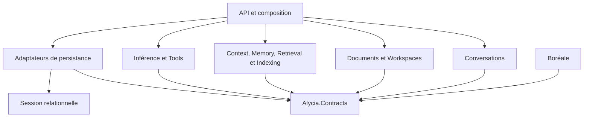

# D02 — Graphe cible et passages de responsabilité

Les identifiants persistants, la révision attendue, la portée autorisée, le budget et le CancellationToken font partie du contrat de chaque opération qui les utilise. Les DTO HTTP actuels et la configuration JSON v1 restent versionnés à la frontière. Une nouvelle projection interne n’ajoute aucun champ au transport. Un changement incompatible nécessite une nouvelle version et un lecteur des données antérieures.

| Consommateur | Port et propriétaire | Données et effet |
|---|---|---|
| Conversations | Préparation de Context | Snapshot de messages, fichiers autorisés, réglages du tour. Retour de fenêtre, métriques et changement mémoire proposé. |
| Conversations | Génération d’Inference | Modèle local et messages, réglages de cet appel, schéma et outils autorisés, callback delta acquitté, annulation. Retour texte/usage ou erreur typée. |
| Conversations | Écriture du tour | Contrôle RequestId, révision, deux messages, diagnostics et mémoire dans la transaction existante. Rejeu sans réinférence. |
| Documents et Conversations | Catalogue Workspaces | Identité et profil valides, contrôle d’archivage, révision. Création du profil et de l’identité atomique ; la destination d’un déplacement est vérifiée dans la transaction. |
| Tools, Retrieval, Indexing | Accès Documents | Lectures bornées par propriétaire, conversation, exclusions et identité de contenu. Vérifier à l’utilisation, y compris en cas de cache ancien. |
| Retrieval et Memory | Recherche vectorielle Indexing | Identité du modèle, clés éligibles ou propriétaire/séquence/date, vecteur de requête ; scores associés à ces clés. Annulation distincte du repli lexical. |
| Context et Tools | Historique Conversations | Lecture paginée dans le snapshot du tour, séquence maximale et portée explicites. Pas d’octroi implicite au projet voisin. |
| Context et Conversations | Préparation Memory | Changement préparé, hash source, intervalle et version ; l’application au tour appartient à l’unité de travail. Les faits temporels dérivés sont recalculables. |
| API | Services de chaque domaine | Opt-ins Development, authentification locale, sérialisation, mapping d’erreurs et NDJSON. La durée de vie scoped préserve le snapshot et l’instance EF. |
| Boréale | API typée et Contracts | DTO transport et événements de présentation. La navigation ne confère pas de permission côté serveur. |

Le DAG physique cible accepte les arêtes du projet de composition vers les adaptateurs, de chaque adaptateur vers ses ports et ses propres règles, et des consommateurs vers les contrats spécialisés. Le projet Contracts n’a aucune référence produit. Un domaine pur ne dépend d’aucun SDK technique. Un projet d’implémentation ne référence jamais directement celui d’un voisin. La transitivité de MSBuild impose de vérifier tous les chemins. Les contrats par domaine peuvent rester dans une seule assembly de transport tant qu’aucune implémentation ne s’y installe.

Les doubles s’injectent dans les mêmes ports, avec données et horloge maîtrisées. Les tests du vrai PostgreSQL couvrent contraintes, rollback et commit incertain. Un double de modèle n’est pas une preuve de débit matériel. Pour les settings, construire une vue immuable avant tout await qui permet à l’appelant de modifier ses réglages. Les objets EF et les chemins disque restent privés.

## Décisions de jonction

- Maintenir RepeatableRead et le verrou non bloquant par conversation sur le chemin Send. Le calcul de contexte n’effectue aucune écriture. La préparation mémoire demandée explicitement conserve son écriture et sa révision dans l’orchestrateur.
- Maintenir l’ordre admission annotation, permis matériel, délai actif puis libération. Le signal de priorité du worker ne constitue pas un verrou de tour.
- Ne pas créer d’outbox pour le ledger. Les jobs persistants existants permettent déjà le recalcul des vecteurs. Une perte d’accusé de commit de fichiers déclenche une vérification indépendante ou la conservation prudente.
- Réserver la politique de stockage à l’adaptateur propriétaire. Le passage entre deux propriétaires en transaction requiert la même connexion, la même transaction et une responsabilité de commit identifiée.

Les essais négatifs attendus couvrent le graphe transitif et cyclique, l’utilisation d’un concret via alias, les imports de fournisseurs NuGet dans un port, les lectures EF et SQL hors propriétaire, la réflexion et un témoin autorisé. Les contraintes sont introduites progressivement sur le produit et les exceptions nommées. Une arête cible dessinée ici ne prouve pas qu’un module l’a déjà adoptée.

## Assemblies cibles et sens des références

Chaque flèche désigne une référence de compilation autorisée. L’API connaît les implémentations pour les enregistrer. Les appels entre propriétaires passent par les interfaces du domaine correspondant dans Contracts. La liste des références effectivement compilées à D19 figure dans [D19-graphe-final.tsv](D19-graphe-final.tsv).

