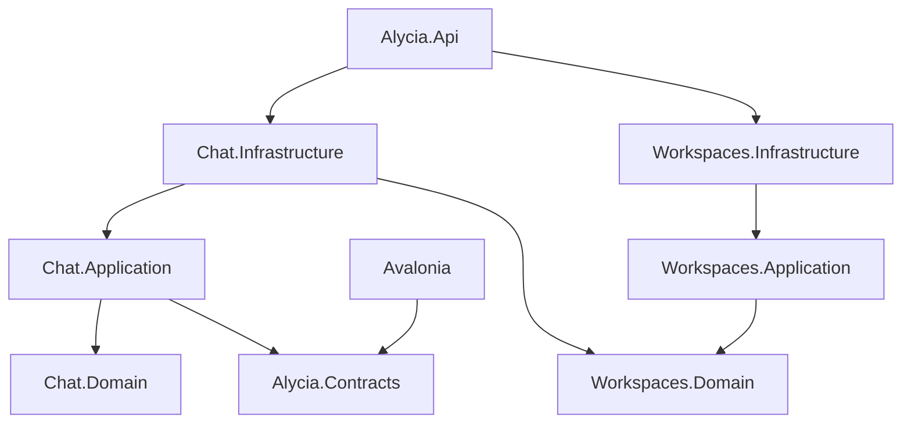

# Implemented module boundaries

The [baseline](baseline.md) records the reference at `309d610`. The deployment still consists of a local Avalonia client, an ASP.NET Core process and PostgreSQL. The application runs its existing background index worker inside the API process. Ollama is contacted through the existing HTTP clients.

## Projects after the refactor

| Product project | Direct project references |
|---|---|
| `Alycia.Api` | `Alycia.Modules.Workspaces.Infrastructure`, `Alycia.Modules.Chat.Infrastructure` |
| `Alycia.Client.Avalonia` | `Alycia.Contracts` |
| `Alycia.Contracts` | None |
| `Alycia.Modules.Chat.Application` | `Alycia.Contracts`, `Alycia.Modules.Chat.Domain` |
| `Alycia.Modules.Chat.Domain` | None |
| `Alycia.Modules.Chat.Infrastructure` | `Alycia.Modules.Chat.Application`, `Alycia.Modules.Workspaces.Domain` |
| `Alycia.Modules.Workspaces.Application` | `Alycia.Modules.Workspaces.Domain` |
| `Alycia.Modules.Workspaces.Domain` | None |
| `Alycia.Modules.Workspaces.Infrastructure` | `Alycia.Modules.Workspaces.Application` |

The solution also contains the Avalonia, Chat and Workspaces test projects. The ContextBenchmarks runner stays outside the solution. The single new assembly, Alycia.Contracts, replaces the former client reference to Chat.Application (and its transitive Domain dependency). The persistence bridge references Workspaces.Domain to use its canonical workspace constructor. The dependency guard verifies all 13 projects, product/test solution membership, imports and the client's transitive graph.

## Product project references

Arrows point from each consumer to its direct dependency.

## Operational boundaries

| Owner | Entry point | Storage, resource or caller |
|---|---|
| Conversations | `ChatService`, `IChatRepository`, `ConversationHistory` | A turn owns its per-conversation lease, snapshot, request identity, memory application and final atomic append. |
| Workspaces and projects | Workspaces application, `IProjectCatalog`, `ProjectFiles` | Canonical name in workspaces.workspaces, revision in chat.workspace_profiles. The Chat adapter uses a shared transaction when both are written. |
| Ingestion | `DocumentImportBatch`, `ArchiveContents`, `DocumentContent`, `FileImport` | Source streams are validated and exhausted before persistent imports; SQL metadata and immutable originals retain their owner and SHA. |
| Index | `IProjectIndex`, `IIndexMaintenance`, `IEmbeddingSimilarityReader`, `IndexCatalog` | The hosted worker resolves a fresh service scope for each execution cycle. Persistent jobs, embeddings and knowledge are versioned by owner. |
| Retrieval | `IProjectRetrieval`, `PassageRanking`, `IPassageReranker` | An eligible corpus is selected before offline ranking, source selection and citation. |
| Context and memory | `ITurnContext`, `IConversationMemory`, `ITemporalMemory`, `ITemporalMemoryIndex` | Preview is read-only. Send and explicit preparation apply pending changes under the owner’s revision/lease. |
| Inference | `IChatModel`, `ILocalEmbeddings`, `ITextTokenCounter` | Ollama adapters share the existing resource reservation; waiting and active inference have distinct cancellation/deadline semantics. |
| Tools | `ITurnTools`, `IProjectTools`, `ISnapshotProjectTools` | Local MCP dispatches to the scoped executor. A project-attached turn can use a snapshot, preserving exclusions and quotas. |
| HTTP | `ChatRegistration`, Chat endpoints, `ConversationResponses` | API maps DTOs, statuses and NDJSON deltas. HTTP security and OpenAPI gates remain in the host. |
| Boréale | [Presentation map](presentation.md) | Presentation state uses the typed HTTP client and wire contracts. |

The [storage inventory](baseline.md) and [ownership decisions](ownership.md) apply to the refactored tree. The client and the contract assembly have no dependency on a server layer. Historic migrations and the two EF contexts remain in their original projects.

## Verifying a change

Run `python3 scripts/check-modules.py` from a checkout. Follow the [parallel contribution guide](CONTRIBUTING-AGENTS.md) to assign a domain, freeze its contract, test it and integrate changes. The [execution report](rapport-execution.md) links the actual test and benchmark results.
